<p align="center">
  
</p>

<p align="center">
  <a href="#quick-start">Quick start</a>&nbsp;&nbsp;·&nbsp;&nbsp;<a href="#tools">Tools</a>&nbsp;&nbsp;·&nbsp;&nbsp;<a href="#run-a-test-by-itself">Test files</a>&nbsp;&nbsp;·&nbsp;&nbsp;<a href="#run-tests-on-a-schedule">Schedules</a>&nbsp;&nbsp;·&nbsp;&nbsp;<a href="#http-api">API</a>&nbsp;&nbsp;·&nbsp;&nbsp;<a href="#security">Security</a>
</p>

<br>

PhantomQA gives an AI agent an Android device to test on. The agent reads the screen, taps, types, scrolls and goes back, the way a person works through an app. PhantomQA watches for crashes and ANRs by itself, and every bug lands in a report with a screenshot, a video clip and the app's log.

It is one small Rust binary. It talks to the agent over [MCP](https://modelcontextprotocol.io) and to the device over `adb`, and it installs nothing on the device.

<p align="center">
  
</p>

- **Sees the screen** as a short numbered list, or as a screenshot for games and custom drawing.
- **Acts like a person**: tap, type in any language, scroll, long press, keys, back.
- **Catches crashes** and ANRs and saves them, without the agent asking.
- **Files bugs** with steps to reproduce, a screenshot, a video clip and the log.
- **Runs alone** from a JSON test file, with exit codes for CI.
- **Runs on a schedule**, daily or every few hours.
- **Serves the results** over a read-only HTTP API with tokens, ready for a dashboard.
- **Keeps the test password from the agent.** It never sees it, and the reports never show it.

## Quick start

**1. Install**

```sh
cargo install --git https://github.com/DryBearr/PhantomQA
```

Or clone the repo and run `cargo build --release`. The binary is `target/release/phantomqa`.

**2. Start an emulator** (or connect a phone with USB debugging), **then check the setup**

```sh
phantomqa doctor
```

```
ok    adb: Android Debug Bridge version 1.0.41 (adb)
ok    device: sdk_gphone64_x86_64, Android 14 (API 34)
ok    screen reading: works (16 elements on screen)
ok    device helper: works (reads the screen in 340 ms)
ok    screenrecord: /system/bin/screenrecord
warn  ffmpeg: not found
      fix: install ffmpeg, or set --ffmpeg or FFMPEG; ...
ok    reports: /home/you/reports is writable
ok    claude: 2.1.322 (Claude Code) (claude)
info  video: on, screenshots: on
```

`doctor` prints one line per check, and a fix for each problem.

**3. Test with Claude Code**

```sh
claude mcp add phantomqa -- phantomqa mcp
```

Then ask: *"Test the app com.example.app. Try the main features and report every bug."*

**4. Or let it run by itself**

```sh
phantomqa run examples/settings.json
```

### Requirements

| What | Needed | Why |
|---|---|---|
| [Rust](https://rustup.rs) | to build | |
| `adb` from [Android platform-tools](https://developer.android.com/tools/releases/platform-tools) | yes | talks to the device |
| An Android emulator, or a phone with USB debugging | yes | the app under test runs here |
| [ffmpeg](https://ffmpeg.org) | no | joins video parts into one clip per bug, and into `session.mp4` |
| [Claude Code](https://claude.com/claude-code) | for `run` | the agent that tests in `phantomqa run` |

For your own MCP config, copy [`.mcp.json.example`](.mcp.json.example) to `.mcp.json`. Add options to `args` if needed, for example `["--adb", "/path/to/adb", "mcp"]`.

## Tools

The agent gets these tools:

| Tool | What it does |
|---|---|
| `launch_app` | start an installed app by package name |
| `screen` | read the screen as a numbered list |
| `tap` | tap element N |
| `type_text` | tap element N and type text, in any language and with emoji. With `clear`, replace what the field holds |
| `type_password` | type the test account's password into password field N. The agent never sees it |
| `scroll` | swipe down, up, left or right in a list or page. Says when the end is reached |
| `long_press` | press and hold element N, for context menus |
| `press_key` | enter, delete, tab or home |
| `look` | a screenshot, for screens the list cannot describe: games, maps, custom drawing |
| `tap_at` | tap a point, in percent of the screen, for apps that draw their own UI |
| `back` | press the back button |
| `crashes` | check for new crashes and ANRs |
| `report_bug` | save a bug: title, steps, expected, actual, severity |

Every action returns the new screen, so the agent needs no extra call to see what happened:

```
app: com.android.settings
[1] EditText "Search settings" #search_action_bar edit
[2] LinearLayout "Network & internet / Mobile, Wi‑Fi, hotspot" click
[3] RecyclerView #recycler_view scroll
```

## Run a test by itself

Describe the test in a JSON file:

```json
{
  "app": "com.example.shop",
  "apk": "build/app-debug.apk",
  "goal": "Test sign up, login, search and the cart.",
  "avoid": ["Delete account", "Pay now"],
  "login": {"user": "qa@example.com", "password_env": "SHOP_QA_PASSWORD"},
  "model": "haiku",
  "max_minutes": 20
}
```

```sh
export SHOP_QA_PASSWORD='...'      # the test account's password
phantomqa run shop.json
```

| Field | Needed | Meaning |
|---|---|---|
| `app` | yes | package name of the app to test |
| `goal` | yes | what to test, in plain words |
| `apk` | no | install this file first (relative to the test file) |
| `avoid` | no | button texts the agent must never press. PhantomQA refuses them, ignoring case |
| `login` | no | a test account for the app's own login screen. `password_env` names the env var that holds the password. The password is never in the file, and must be printable ASCII |
| `model` | no | Claude model: `haiku`, `sonnet` (default) or `opus` |
| `max_minutes` | no | stop the agent after this long (default 30) |
| `clear_data` | no | `true`: clear the app's data first, like a fresh install |
| `snapshot` | no | load this emulator snapshot first, so every run starts from the same state |

- Exit code `0` means no bugs, `1` bugs found, `2` the run failed. So it fits CI and cron.
- `run` checks everything before it starts: the file (unknown fields are errors), the password env var, Claude Code, the device and the app.
- The agent gets PhantomQA's tools and nothing else: no shell, no files, and none of your own Claude Code settings or hooks.
- `report.md` gets an `## Agent` part: the model, how the run ended, its cost and the agent's summary.
- One run per device at a time. A second run on the same device stops with "busy".
- Try it on any emulator with [examples/settings.json](examples/settings.json).

<details>
<summary>Logins and snapshots</summary>

<br>

- The agent types the user name itself, and calls `type_password` for the password field.
- PhantomQA types the password only into fields marked as password fields, and hides it in everything the agent and the report see.
- `snapshot` works on emulators only. Save one once, with the device the way each test should start: `adb emu avd snapshot save clean`. Then set `"snapshot": "clean"`. On a phone, use `clear_data` instead.

</details>

## Run tests on a schedule

`phantomqa serve` also runs the tests listed in `routines.json`:

```json
{
  "routines": [
    {"name": "nightly", "test": "shop.json", "at": "03:00"},
    {"name": "smoke", "test": "smoke.json", "every": "6h"}
  ]
}
```

| Field | Meaning |
|---|---|
| `name` | letters, digits, `.`, `_` and `-`. Each name only once |
| `test` | a test file, as for `run` (relative to `routines.json`) |
| `at` | once a day at this time, like `"03:00"` |
| `every` | minutes or hours that split a day evenly, counted from midnight. `"6h"` runs at 00:00, 06:00, 12:00 and 18:00 |

Each routine has `at` or `every`, not both.

```sh
phantomqa routines        # check the file and each test file, and show when each runs next
phantomqa serve           # run the routines, and the API
phantomqa serve --no-api  # run only the routines: no API, no tokens needed
```

Try it with [examples/routines.json](examples/routines.json): `phantomqa --routines examples/routines.json routines`.

<details>
<summary>How the schedule behaves</summary>

<br>

- Times are this machine's local time. Set `TZ` for another zone, like `TZ=UTC phantomqa serve`.
- On clock-change days, a time that does not exist runs right after the change. A time that happens twice runs once.
- `serve` reads the file every second, so changes apply at once. A broken file runs nothing until it is fixed, and `serve` says why.
- If a routine's last run is still going, it skips its turn. If another run has the device, the routine skips too. `serve` logs each skip.
- Times missed while the machine sleeps or `serve` is down are not made up. `serve` logs a missed time once.
- If the clock goes back, a time that just ran does not run again. If the clock was far ahead and is set right, the routine runs again once a real period has passed.
- Each run is a normal run folder. Its `test` in `run.json` has `"routine": "nightly"`, and `report.md` has a `Routine` line.
- Set the test files' password env vars where `serve` runs.
- If `serve` (or `phantomqa run`) stops during a run, the agent stops too (on Linux). The session still finishes, and the agent part says `stopped`.
- With systemd, set `KillMode=mixed`, so a stop reaches `serve` first and the session can finish. Otherwise everything stops at once and the run shows as `interrupted`.

</details>

## Use by hand

```sh
phantomqa launch com.android.settings   # start an app, print its screen
phantomqa screen                        # print the current screen
phantomqa tap 3                         # tap element [3]
phantomqa type 2 hello world            # tap element [2] and type text
phantomqa scroll down                   # scroll the biggest list; also up, left, right, or `scroll down 3`
phantomqa long-press 4                  # press and hold element [4]
phantomqa key enter                     # enter, delete, tab or home; `key delete 5` presses it 5 times
phantomqa tap-at 50 30                  # tap a point, in percent of the screen
phantomqa back                          # press back
phantomqa crashes                       # list crashes and ANRs in the device's crash log
```

## Reports

Each session gets the next numbered folder:

```
reports/run-001/
  report.md      one section per bug, and the video at the end
  run.json       status and bugs, for the API
  bug-01.png     screenshot
  bug-01.mp4     video of the last 15-60 seconds before the bug
  bug-01.log     crash lines and the app's recent log
  session.mp4    the whole session
```

- After every action, PhantomQA reads the device's crash log. A new crash, native crash or ANR of the app under test is shown to the agent and saved to the report.
- The same crash is saved once, even in a crash loop. Crashes of other apps are mentioned to the agent, not saved.
- Each bug gets a screenshot, a video clip, the app's log and the recent actions, so a person can follow the same path.

<details>
<summary>Video</summary>

<br>

PhantomQA records the screen with `screenrecord` in 30-second parts. When a bug is saved, the current part ends there, so the clip shows what led to the bug. When the session closes, the parts are joined into `session.mp4`.

- Without ffmpeg, a clip of one part is still made. Clips that need two parts, and the session, stay as parts in `video/`, linked from the report.
- Android only records a frame when the screen changes, so still moments are shorter in the video than in real time.
- Screens that block screenshots (some banking apps, password screens) record as black.
- Agents kill their MCP server right after they exit. The session runs in a separate process, so it still finishes: the last part, `session.mp4` and `run.json`.
- If PhantomQA itself is killed, `session.mp4` is not made. The parts stay in `video/`.
- Turn video off with `--no-video`, and screenshots with `--no-screenshots`.

</details>

## Device helper

PhantomQA copies a small helper (6 KB) to the device, to read the screen and type faster:

- It reads the screen in about 0.3 s, where `uiautomator dump` takes 2 s. An action and its new screen take about 0.5 to 1.5 s.
- It types any text: accents, other scripts and emoji. `input text` types only ASCII.
- It knows where the on-screen keyboard is, so PhantomQA refuses taps on keys by mistake and keeps scrolls above the keyboard.

<details>
<summary>Why it is safe to leave on</summary>

<br>

- It runs over adb as the shell user, like `uiautomator`. It installs no app, opens no port and asks for no permission.
- It talks to PhantomQA only through that adb connection, and stops when the session ends.
- It is one file you can read: [helper/Helper.java](helper/Helper.java). The built `helper/phantomqa-helper.jar` is in the repo and inside the binary, so you need no Java. Rebuild it after a change with `ANDROID_HOME=/path/to/sdk helper/build.sh`, which needs a JDK and the Android SDK.
- It lives in `/data/local/tmp/phantomqa-helper-*.jar`. A new version replaces the old one, and a broken copy is replaced on its own.
- If it cannot run, PhantomQA reads the screen with `uiautomator dump` and types with `input text`. `doctor` shows whether it works. Turn it off with `--no-helper` or `PHANTOMQA_HELPER=0`.

</details>

## HTTP API

`phantomqa serve` starts a read-only JSON API over the reports, for a dashboard or scripts. It listens on `127.0.0.1:7070` and needs a token on every `/v1` route.

```sh
TOKEN=$(phantomqa token add dashboard --expires 90d)
phantomqa serve
curl -H "Authorization: Bearer $TOKEN" http://127.0.0.1:7070/v1/runs
```

| Endpoint | Returns |
|---|---|
| `GET /health` | up or not (no token) |
| `GET /v1/runs` | runs, newest first |
| `GET /v1/runs/{run}` | status, device, bugs and files of one run |
| `GET /v1/runs/{run}/files/{name}` | report, screenshots, videos (with seeking), logs |
| `GET /openapi.json` | the OpenAPI description (no token) |

A dashboard page on any website can call `/v1` from the browser (CORS), with its token in the `Authorization` header. A website without a token gets nothing.

Full docs: [docs/api.md](docs/api.md). Each run folder also has `run.json`, the same data as `GET /v1/runs/{run}`.

<details>
<summary>Tokens</summary>

<br>

Give each client, such as a dashboard or CI, its own token.

```sh
phantomqa token add dashboard --expires 90d   # prints pqa_... once; store it in the dashboard
phantomqa token list                          # names, ids and expiry, never the tokens
phantomqa token rotate dashboard --grace 1h   # new token; the old one works for 1 more hour
phantomqa token remove dashboard --old        # end that hour early
phantomqa token remove dashboard              # revoke now
echo "$TOKEN" | phantomqa token check         # does this token work?
```

- Clients send `Authorization: Bearer pqa_...`.
- `tokens.json` keeps only SHA-256 hashes, is readable only by you, and is written atomically under a lock.
- Removing or rotating a token takes effect on the next request. A broken `tokens.json` refuses every token.
- Tokens go to stdout alone, so `TOKEN=$(phantomqa token add ci)` works.

</details>

## Options

Put options before the command. Each option also has an env var, which is handy in MCP configs. An option wins over its env var.

| Option | Env var | Default |
|---|---|---|
| `--adb PATH` | `ADB` | `$ANDROID_HOME/platform-tools/adb` (or `ANDROID_SDK_ROOT`), then `adb` on PATH |
| `--serial ID` | `ANDROID_SERIAL` | the only connected device |
| `--reports DIR` | `PHANTOMQA_REPORTS` | `reports` |
| `--ffmpeg PATH` | `FFMPEG` | `ffmpeg` on PATH |
| `--no-video` | `PHANTOMQA_VIDEO=0` | video on |
| `--no-screenshots` | `PHANTOMQA_SCREENSHOTS=0` | screenshots on |
| `--no-helper` | `PHANTOMQA_HELPER=0` | device helper on |
| `--tokens PATH` | `PHANTOMQA_TOKENS` | `tokens.json` |
| `--claude PATH` | `PHANTOMQA_CLAUDE` | `claude` on PATH |
| `--routines PATH` | `PHANTOMQA_ROUTINES` | `routines.json` |

Example: `phantomqa --serial emulator-5554 --reports ~/qa --no-video mcp`

## Security

- **The agent's reach.** `phantomqa run` gives the agent PhantomQA's tools only: no shell, no files. The `avoid` list makes PhantomQA refuse buttons such as "Pay now".
- **Passwords.** They come from an env var, go only into password fields, and are hidden from the agent and the reports.
- **The API.** It is read-only and listens on this machine only, unless you pass `--listen`. `tokens.json` keeps only hashes. To reach the API from other machines, put an HTTPS proxy in front.
- **The device.** The helper installs no app, opens no port and asks for no permission.
- **Test devices only.** The agent taps through apps on its own. Use an emulator or a test phone, never a device with your personal accounts.

Found a security problem? Please report it privately: open the repo's **Security** tab and choose **Report a vulnerability**.

## Limits

- Apps that draw their own UI (games, Flutter without semantics) show few or no elements. The agent uses `look` and `tap_at` there, and the avoid list cannot protect buttons that are only drawn.
- Without the device helper, each action takes about 3 seconds, typing is printable ASCII only, and PhantomQA cannot tell what the keyboard covers.
- Text typed through the helper goes in like a paste, not key by key. Non-ASCII text cannot go into password fields.
- `phantomqa run` uses Claude Code as the agent. The MCP server works with any MCP client.
- Status: early (0.1). Built and tested on Linux with the Android emulator. macOS and Windows are untested.

## License

[MIT](LICENSE)
